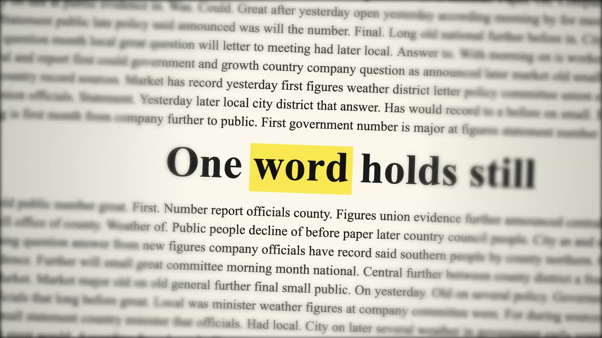
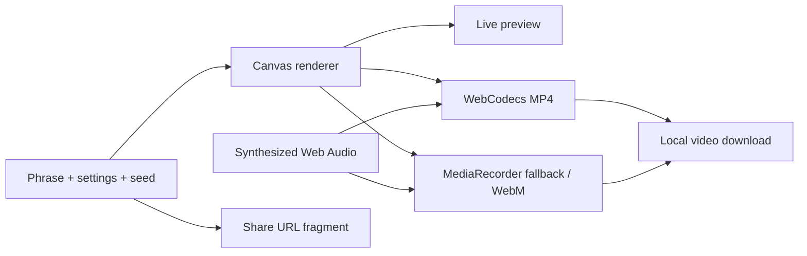

<div align="center">


# Pressflick

**One word holds still. The page keeps changing.**

Turn a phrase into a newspaper-style text match-cut video.<br>
Choose the word to lock, tune the cuts, and download in 1080p — entirely in your browser.

**[Live demo](https://pressflick.vercel.app) · [Open the editor](https://pressflick.vercel.app/editor.html) · [Watch a real export](assets/pressflick-demo.mp4)**

Free · No watermark · No account · No ads or tracking · MIT licensed

</div>

[](assets/pressflick-demo.mp4)

*A five-second export made with Pressflick, including synthesized paper sound. Click the poster to watch. Rapid cuts; play when you’re ready. [Export measurements and limits](docs/EXPORT-QUALITY.md).*

## Make a match cut

1. **Write a phrase.** Tap the word that should stay in place.
2. **Set the feel.** Pick the paper, highlighter, sound, pace and framing.
3. **Download the video.** Choose MP4 or WebM, or copy a link to the same settings.

The landing page lives at `/`; the editor lives at `/editor.html`. There is no installation or sign-in step to use either.

## Try and share a cut

- Pick **Plot twist**, **After hours** or **Next move** to preview a real clip and open its settings in the editor. [Starter cuts](https://pressflick.vercel.app/#starters)
- Step through six frames of the sample with the cut inspector. Select a format thumbnail to open the editor in that aspect ratio.
- Download the sample MP4 or copy the public site link. Your browser can open its share menu where supported. [Share kit](https://pressflick.vercel.app/#share-kit)

## What you can make

- **A locked focal word.** Generated newspaper-style pages change around your chosen word; shuffle for a new sequence.
- **Your own pace.** Clips from 2–10 seconds, with 4–16 cuts per second, adjustable zoom and blur.
- **Paper and colour.** Newsprint or mixed dark pages, with a custom highlighter colour.
- **Synthesized sound.** Paper shuffle, camera shutter, film advance, Polaroid or flash pop — or silence. Preview is silent; **Hear it** auditions one sound.
- **MP4 and WebM downloads.** Output is generated locally, without a watermark. Browser capabilities determine the available encoding path.
- **Repeatable links.** Copy link includes the phrase, settings and page seed, so the recipient can recreate the sequence.
- **Motion controls.** Pause the preview at any time. Reduced-motion preferences start it paused and stop the landing animation.

| Layout | Resolution | Aspect ratio |
| --- | --- | --- |
| Vertical | 1080 × 1920 | 9:16 |
| Square | 1080 × 1080 | 1:1 |
| Landscape | 1920 × 1080 | 16:9 |

## Private by design

Your phrase, preview and export stay in the browser. Pressflick has no backend, accounts, analytics, telemetry, cookies or persistent browser storage. Fonts and runtime assets are served locally from the site; no AI service or API key is involved.

Shared settings go after `#` in the URL. That fragment is excluded from HTTP requests, but **anyone with the link can read the phrase**. Query-string settings are deliberately ignored; do not put private text into a URL query. See [privacy](privacy.html) and the [security boundary](docs/SECURITY.md).

## Run locally

**Requirements:** Python 3.11+ for the local server; Node.js and npm for development tools and packaging.

From the repository directory:

```bash
npm start
```

Open [the landing page](http://127.0.0.1:5173) or [the editor](http://127.0.0.1:5173/editor.html). No runtime package install, environment variables or application build is needed.

If port 5173 is busy:

```bash
python3 -m http.server 5176 --bind 127.0.0.1 --protocol HTTP/1.1
```

This development server exposes the checkout on loopback. Public hosting must use the [packaged allowlist](#package-and-host).

## How it works

Static HTML and CSS, Canvas 2D, Web Audio and native JavaScript modules. No framework or bundler. The preview draws each cut from elapsed time and a seed rather than holding a collection of full-resolution frames in memory.



| Module | Responsibility |
| --- | --- |
| [`src/core.js`](src/core.js) | Pure word, timing, seeded-random and format-selection logic |
| [`src/render.js`](src/render.js) | Deterministic canvas cuts and focal-word positioning |
| [`src/audio.js`](src/audio.js) | Synthesized sounds; no recorded samples |
| [`src/export.js`](src/export.js) | WebCodecs encoding and in-memory MP4 muxing |
| [`src/app.js`](src/app.js) | Editor state, preview, sharing and real-time recording |
| [`src/presets.js`](src/presets.js) | Original starter settings and editor links |

The only runtime dependency is the vendored, MIT-licensed [`mp4-muxer`](src/vendor/). Playwright and axe are development tools and are excluded from the hosted package. The [architecture](docs/ARCHITECTURE.md) and [decision record](docs/MEMORY.md) explain the trade-offs.

## Test and verify

```bash
npm ci                                      # development dependencies only
npm test                                    # pure logic and packaging checks
npx playwright install chromium firefox webkit
npm run test:e2e                             # Chromium, Firefox and WebKit
```

Playwright starts its own server at `127.0.0.1:5174`; keep that port free. Tests cover editor flows, fragment sharing, export fallbacks, real downloaded video files and accessibility checks. The fixtures fail on console/page errors, HTTP 5xx responses and axe violations.

See [verification](docs/VERIFICATION.md), [export quality](docs/EXPORT-QUALITY.md) and [review reports](docs/reviews/) for recorded evidence and its scope. Automated browser checks do not establish physical-device or human playback quality.

## Browser and export limits

- **WebCodecs MP4** renders and encodes each frame at 30 fps when the browser supports the required codecs. Tested video timing is frame exact; AAC priming and padding can make the audio/container duration slightly longer.
- **WebM and fallback exports** record in real time with MediaRecorder. Keep the tab visible until it says **Saved**. They can stutter or vary in duration; the saved message and extension identify the actual container.
- **Capability checks run before export.** Unsupported recording gets a message; failed MP4 encoding can fall back to real-time recording. Controls stay locked while export runs.
- **Memory and rendering vary by device.** MP4 is muxed in memory, system fonts vary, and older canvas implementations may omit blur. Low-memory and repeated-export stress testing remain open.
- **Rapid cuts remain rapid in the exported video.** Reduced motion pauses the initial preview; it does not change the requested export. The owner reported completion of the human checklist for the preceding release. [Human checks](docs/HUMAN-CHECKS.md)

## Package and host

The app is live on **[Vercel](https://pressflick.vercel.app)**. The source repository remains private. Publishing the repository or changing hosting is a separate owner decision.

Package only the public files into a **new, empty directory**:

```bash
node scripts/prepare-site.mjs release/pressflick-review https://pressflick.vercel.app
```

This copies an explicit allowlist without compilation and replaces the marked social-URL placeholder in output HTML. It rejects symlinks and nonempty output directories. **Host that output directory, never the repository root.**

[`vercel.json`](vercel.json) supplies the static-site routing and security headers. Follow the [Vercel deployment runbook](docs/DEPLOY.md#vercel-production--10-november-2026) for the CLI workflow and project link; it supersedes the earlier Cloudflare plan. A new public file must be added to the packaging allowlist and covered by the packaging test.

## Contribute

Keep it static, build-free and private by default. Put pure logic in `src/core.js` with Node tests, preserve both export paths, and update the matching docs when behaviour changes. Read the [contributor instructions](AGENTS.md), [product rules](docs/RULES.md) and [architecture](docs/ARCHITECTURE.md) before proposing a change. Report bugs with the browser/device, settings, output format and reproduction steps; use non-sensitive sample text.

The generated pages are fictional. Do not present them as real headlines or quotations.

## License

[MIT](LICENSE). The vendored muxer retains its MIT licence; the self-hosted Archivo and Montagu Slab fonts retain their SIL Open Font Licenses. Asset origins are recorded in [assets/SOURCES.md](assets/SOURCES.md).
